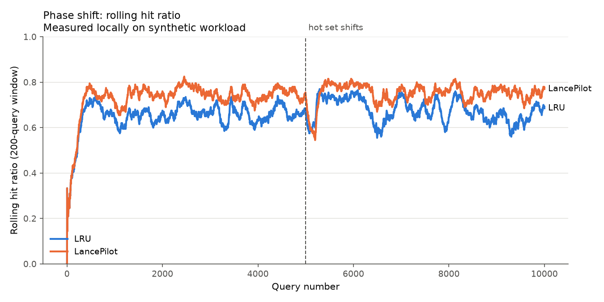
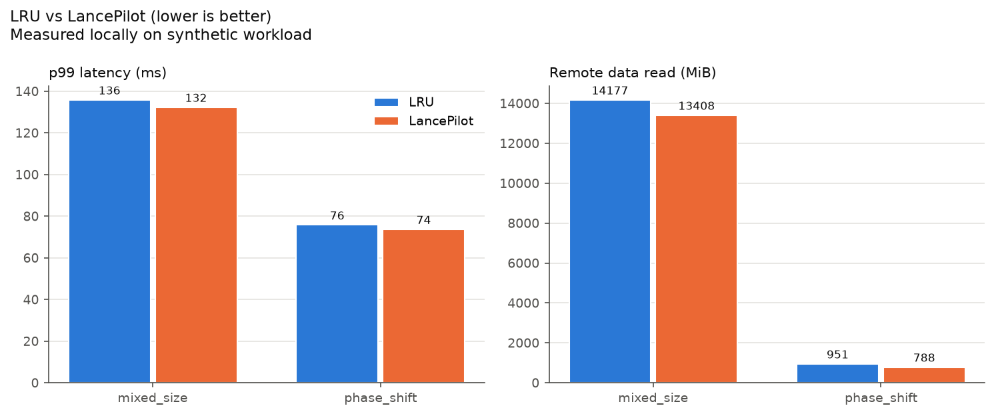

# LancePilot

**Workload-aware cache admission for object-storage-native retrieval**

> LancePilot is an independent experimental project and is not an official LanceDB component.

All benchmark numbers in this README are **Measured locally on synthetic data**. They are
simulation results, not production performance.

## 1. What LancePilot is

A small, deterministic, trace-driven simulator that compares two policies for a single
byte-bounded RAM cache that sits in front of a simulated remote object store:

- **LRU**: admits every miss and evicts least recently used objects until the new object fits.
- **LancePilot**: scores objects by decayed access heat, remote fetch cost and size. It only
  admits a miss when that miss is worth more than everything it would displace.

## 2. LanceDB relevance

Object-storage-native retrieval systems, such as those built on the Lance format, serve
queries from data in S3-like storage. A local memory tier holds hot index and data pages.
Remote reads are slow and their cost varies by object. Memory is constrained, object sizes
vary widely, and query locality shifts over time. Which objects get admitted to that memory
tier directly drives tail latency and egress. This project studies that problem in
isolation. It does not model or reproduce LanceDB internals.

## 3. Hypothesis

> A workload-aware cache admission policy can reduce tail latency and remote storage traffic
> versus LRU when object sizes, remote fetch costs, and workload locality vary.

## 4. Architecture

```text
Synthetic Query Trace (workload.py, fixed seed)
        |
        v
 Workload Profiler (per-object decayed heat, inside LancePilotPolicy)
        |
        v
 Cache Policy (policies.py)
   |       |
   |       +---- LRU baseline
   |
   +------------ LancePilot
        |
        v
     RAM Cache (cache.py, strict byte capacity)
        |
 miss   v
 Simulated Remote Store (simulator.py, no sleeping, latency is accounted)
        |
        v
 Metrics + Benchmark Report (metrics.py, benchmark.py, cli.py)
```

Each query requests exactly one object. Latency is `0.1 ms` on a RAM hit and the object's
`remote_fetch_ms` on a miss. The simulator asserts `used_bytes <= capacity_bytes` after every
query. Objects larger than the whole cache are never admitted.

## 5. LancePilot scoring and admission logic

Time is the logical query index `t`. For each object `i` (resident or not):

```text
heat_i(t)     = sum over past accesses k of (1 - alpha) ** (t - t_k)
                i.e. on each access: heat <- (1 - alpha) ** dt * heat + 1
size_weight_i = max(size_bytes_i / median_object_size, epsilon)
value_i       = heat_i * remote_fetch_ms_i / size_weight_i
```

Every object's heat decays by the same factor per query, so decay never reorders values.
The implementation therefore stores a time-invariant log score that changes only when the
object is accessed. Residents sit in a lazy min-heap keyed by `(score, object_id)`, so
tie-breaking is deterministic.

**Admission on a miss:**

1. If `size > capacity`, reject.
2. If the object fits in free space, admit.
3. Otherwise, pop the lowest-value residents until enough bytes would be freed.
4. Admit only if the candidate's value is strictly greater than every selected victim's
   value. Then evict those victims. If not, roll back. Nothing is evicted and the object is
   served from remote without being cached.

The result prefers objects that are recently or frequently used, expensive to fetch, and
small. One-hit cold objects usually cannot displace a warm resident, which makes the
policy scan-resistant.

## 6. Experimental setup

Both policies run on the **identical trace** for each experiment. All objects and traces
are synthetic and generated from a fixed seed.

Object model: sizes are lognormal around a 256 KiB median and clipped to 4 KiB..16 MiB.
Fetch cost is a per-partition first-byte latency times a per-object lognormal jitter, plus
size / 100 MB/s.

| | Experiment A: phase shift | Experiment B: mixed size + Zipf |
|---|---|---|
| Config | `configs/phase_shift.yaml` | `configs/mixed_size.yaml` |
| Seed | 42 | 7 |
| Objects / queries | 1,000 / 10,000 | 5,000 / 50,000 |
| Access pattern | 80% uniform over hot set; hot set is objects 0..49, then 50..99 from query 5,000 | Zipf s=0.9 over a random permutation, so popularity is independent of size and cost |
| Size spread (lognormal sigma) | 0.6 | 1.2 |
| Partitions / first-byte latency | 8 / 15..80 ms | 16 / 10..120 ms |
| Cache capacity | 6% of dataset (17.6 MiB of 292.6 MiB) | 5% of dataset (124.1 MiB of 2,482.2 MiB) |
| LancePilot alpha | 0.01 | 0.001 |

**Phase-shift metrics.** Pre-shift steady state is the hit ratio over the 2,000 queries
before the shift. Post-shift steady state is the hit ratio over the last 2,000 queries.
**Recovery** is the number of post-shift queries until the trailing 200-query hit ratio,
computed only over post-shift queries, first reaches 95% of that policy's own pre-shift
steady state. Because of the window, the minimum possible value is 200.

Alpha and epsilon were set once before the first run and were not tuned against these
results.

## 7. Measured results

**Measured locally on synthetic data.** Reproduce with `make benchmark`. Raw numbers are in
`results/*.json`.

### Experiment A: phase shift

| Metric | LRU | LancePilot |
|---|---:|---:|
| p50 latency (ms) | 0.10 | 0.10 |
| p95 latency (ms) | 62.65 | 58.05 |
| p99 latency (ms) | 75.78 | 73.69 |
| mean latency (ms) | 15.09 | 11.32 |
| hit ratio | 0.6652 | 0.7435 |
| remote requests | 3,348 | 2,565 |
| remote MiB read | 951.2 | 788.2 |
| evictions | 3,283 | 2,384 |
| pre-shift steady hit ratio | 0.6605 | 0.7425 |
| first 200 queries after shift | 0.6050 | 0.5500 |
| post-shift steady hit ratio | 0.6605 | 0.7535 |
| recovery (queries) | 206 | 266 |



### Experiment B: mixed sizes + Zipf

| Metric | LRU | LancePilot |
|---|---:|---:|
| p50 latency (ms) | 21.39 | 0.10 |
| p95 latency (ms) | 104.74 | 98.11 |
| p99 latency (ms) | 135.87 | 132.31 |
| mean latency (ms) | 31.68 | 23.79 |
| hit ratio | 0.4321 | 0.5612 |
| remote requests | 28,396 | 21,941 |
| remote MiB read | 14,176.7 | 13,408.2 |
| evictions | 28,140 | 16,484 |



## 8. Interpretation

- **The hypothesis holds on both synthetic workloads, but the tail gain is small.**
  LancePilot cut p99 by 2.8% in A and 2.6% in B. It cut p95 by 7.3% and 6.3%.
- **The larger wins are in mean latency, hit ratio and remote traffic.** Mean latency fell
  25% in both experiments. Remote requests fell 23%. Remote bytes fell 17% in A and 5.4%
  in B.
- **Remote bytes improve less than remote requests in B.** LancePilot favors small and
  expensive objects. It gives up hits on large objects, which carry many bytes each.
- **p99 is bounded by misses on the most expensive objects.** Neither policy can keep the
  whole expensive cold tail resident at 5 to 6% capacity. Admission control mostly
  helps the body of the distribution.
- **LancePilot adapts more slowly after a phase shift.** Its first post-shift window drops
  below LRU's: 0.55 versus 0.605. It needs 266 queries to reach 95% of its pre-shift level
  versus 206 for LRU. Stale heat on the old hot set must decay before new objects can win
  admission. It then settles at a higher steady state, 0.754 versus 0.661. That target is
  also stricter than LRU's, because recovery is measured against each policy's own baseline.

## 9. Limitations

- All data is synthetic. Each query reads one object. There is no concurrency, queueing,
  request coalescing, network variance or prefetching.
- Remote latency is a fixed per-object number. Real object-store tails are stochastic.
- There is a single RAM tier. There is no NVMe tier, and there is no distributed cache.
- Heat is kept for every object ever seen. A real system would bound this with a sketch,
  such as a Count-Min, or with a ghost list.
- Each experiment uses one seed, one capacity and one alpha. There is no sweep over cache
  sizes, skew or alpha, and no confidence intervals.
- LRU is the only baseline. LancePilot was not compared with GDSF, TinyLFU, ARC or S3-FIFO.
- The recovery metric is relative to each policy's own pre-shift level and is quantized by
  the 200-query window.

## 10. Running locally

Requires Python 3.12.

```bash
make install    # creates .venv and installs the package with dev tools
make demo       # phase-shift benchmark: LRU vs LancePilot, table + chart
make benchmark  # both experiments + p99 / remote-bytes chart
python -m lancepilot.cli benchmark --config configs/phase_shift.yaml   # with PYTHONPATH=src or after install
```

Outputs:

- `results/phase_shift.json`
- `results/mixed_size.json`
- `results/phase_shift_rolling_hit_ratio.png`
- `results/p99_and_remote_bytes.png`

## 11. Tests

```bash
make test        # pytest
make lint        # ruff check .
make typecheck   # mypy --strict on src
```

The tests cover these cases:

- LRU eviction order and multi-object eviction for a large insert.
- Capacity is never exceeded on random traces, for both policies.
- Oversized objects are rejected.
- LancePilot prefers higher-value objects, rejects lower-value candidates and favors
  smaller objects at equal cost.
- LancePilot heat decay math is correct and a hot object survives a cold scan.
- The same seed gives identical traces and different seeds give different traces.
- A fully deterministic end-to-end benchmark run.
